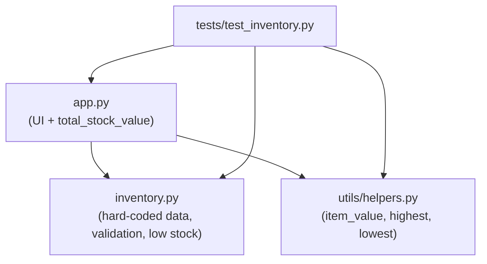
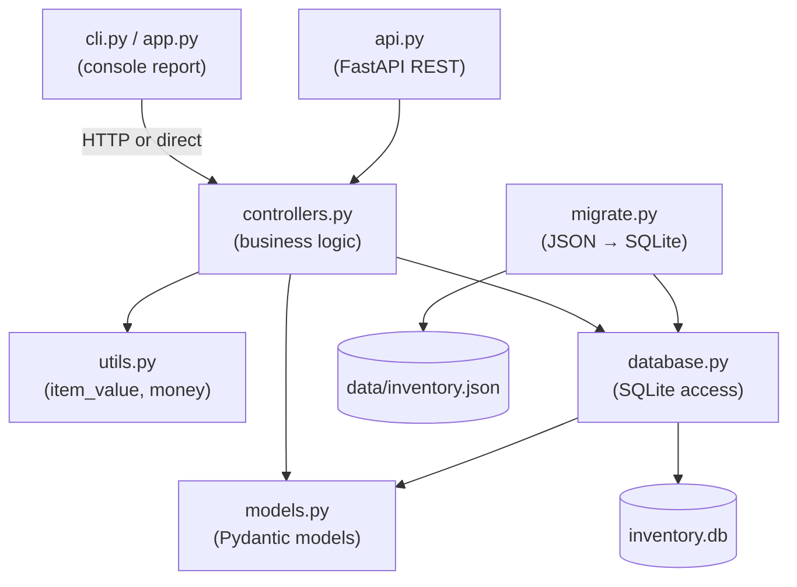

# Lab 4 – Reverse Engineering of Inventory Manager v1.0

This document analyses the **v1.0** code base (tag `v1.0`, produced in Lab 3, built on the maintenance practices from Lab 2) before it is re-engineered into **v2.0**.

## 1. Inventory of modules, classes and functions (v1.0)

| Module | Classes / types | Functions | Constants / globals |
|--------|-----------------|-----------|---------------------|
| `app.py` | – | `total_stock_value()`, `print_header()`, `print_stock_table()`, `print_summary()`, `main()` | `WIDTH`, `LINE` |
| `inventory.py` | `Item` (TypedDict), `Inventory` (type alias) | `validate_item()`, `add_item()`, `low_stock_items()` | `LOW_STOCK_THRESHOLD`, `CURRENCY`, **`inventory` (global mutable list)** |
| `utils/helpers.py` | – | `item_value()`, `highest_stock_item()`, `lowest_stock_item()` | – |
| `tests/test_inventory.py` | `TestCalculations`, `TestFeatures` | 8 test methods | `SAMPLE` |

## 2. Dependency diagram (v1.0)

### Workflow (v1.0)

1. `app.main()` calls `inventory.add_item()`, which **mutates the global `inventory` list**.
2. `app.print_stock_table()` reads the global list and calls `helpers.item_value()` for each row.
3. `app.print_summary()` calls `app.total_stock_value()`, `helpers.highest_stock_item()`, `helpers.lowest_stock_item()` and `inventory.low_stock_items()`.
4. When the program exits, every change is lost – there is no storage.

## 3. Coupling and code smells found

| # | Smell / problem | Where | Impact |
|---|-----------------|-------|--------|
| 1 | **Hard-coded data** – the stock list is Python source code | `inventory.py` | Changing stock needs a code change and a new release; data and code are versioned together. |
| 2 | **No persistence** – items added at runtime disappear on exit | `inventory.add_item()` | The application cannot be used for real stock keeping. |
| 3 | **Global mutable state** – `add_item()` appends to a module-level list | `inventory.inventory` | Hidden coupling: any module can change the data; tests can affect each other. |
| 4 | **Business logic in the presentation layer** – `total_stock_value()` lives next to `print_*` functions | `app.py` | Tests must import the UI module (`tests → app`); logic cannot be reused by another interface. |
| 5 | **Low cohesion / scattered logic** – statistics are split across three modules (`total` in app, `highest/lowest/item_value` in helpers, `low_stock` in inventory; `total units` is computed inline) | all | Hard to find and change calculations. |
| 6 | **Manual validation** – long `isinstance` chains | `validate_item()` | Verbose and easy to get wrong; not reusable for an API. |
| 7 | **No identifiers** – items are only identified by name | data | Cannot safely update or delete a single item; duplicates are possible. |
| 8 | **Single interface** – console only | `app.py` | Other systems cannot read or update the stock. |

## 4. Re-engineering plan (v2.0)

| Smell | Action |
|-------|--------|
| 1 | Export the hard-coded list to `data/inventory.json` (legacy data file). |
| 1, 2 | **Migrate** JSON → **SQLite** (`inventory_app/migrate.py`); all reads/writes go through `database.py`. |
| 3, 7 | Items get an `id` primary key; no module-level mutable list – data lives in the database. |
| 4, 5 | Split into layers: `models.py` (data shapes), `controllers.py` (business logic), `utils.py` (shared calculations/formatting), `database.py` (persistence), `api.py` and `cli.py` (interfaces). |
| 6 | Replace manual checks with declarative **Pydantic** models (`ItemCreate`). |
| 8 | Add a **FastAPI** REST API; package everything with **Docker Compose**. |

## 5. Target architecture (v2.0)

Dependencies now point in **one direction** (interface → controller → database), so each layer can be changed or tested on its own.
